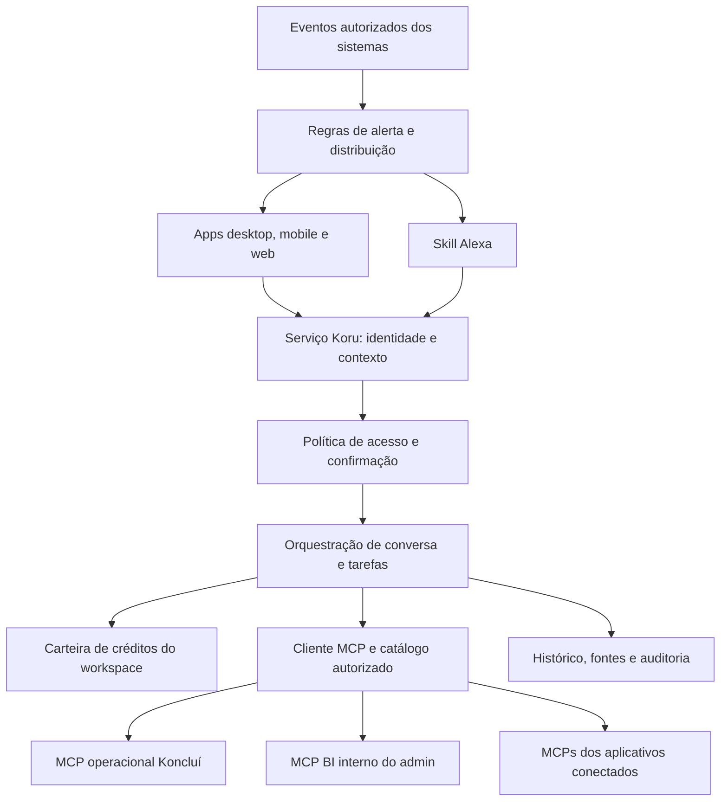

# Arquitetura, MCPs, identidade e memória

[Índice](README.md) · 2026-10-30 · MCP como fronteira de integração é direção aceita; a composição abaixo é proposta.

## 1. Um produto, vários clientes

A seta para Alexa representa somente os mecanismos de notificação que o canal permitir; não promete fala espontânea ou abertura remota da skill. Eventos de origem podem chegar por webhook, fila ou consulta agendada. MCP é a fronteira para ferramentas e recursos de negócio; não é, sozinho, um barramento de eventos ou um mecanismo de autenticação universal.

A implementação pode reutilizar serviços da plataforma. Não foi escolhido framework único para todos os aplicativos, provedor de modelo, banco de memória ou motor de voz.

## 2. Integrações por MCP

**Decisão do produto:** a Koru acessa o Koncluí atual e os aplicativos do negócio através de MCPs. A Koru é o host/cliente de ferramentas; cada servidor MCP traduz suas operações para o sistema dono do dado.

- O sistema de origem continua sendo autoridade para registros, permissões e regras de negócio.
- Um MCP operacional Koncluí deve encapsular APIs e operações existentes; não reimplementar regras em prompts.
- Se um fornecedor não tiver MCP adequado, avaliar um adaptador MCP mantido pela Koncluí sobre uma API autorizada. Não prometer conectividade por simples existência de um endpoint.
- Priorizar conectores por jornada e demanda de clientes: ERP/PDV, estoque/compras, financeiro, CRM, agenda, comunicação, documentos e BI. Marcas e ferramentas concretas dependem de inventário, autorização e suporte comprovado.
- Cada instalação de conector tem workspace, proprietário, escopos, recursos autorizados, estado, versão e revogação.
- Credenciais duráveis ficam no backend/armazenamento seguro; nunca em prompts, artefatos, logs ou pacotes distribuídos.
- Preferir OAuth e tokens emitidos para o recurso correto. Não reutilizar indiscriminadamente o token recebido para acessar APIs de terceiros. Referência: [segurança MCP](https://modelcontextprotocol.io/docs/2025-11-25/tutorials/security/security_best_practices).

### Catálogo de capacidades proposto

Os nomes abaixo são exemplos de contrato futuro, não ferramentas já implementadas.

| Capacidade | Exemplo de ferramenta | Efeito e evidência |
|---|---|---|
| Consultar operação | `get_shift_summary` | Leitura agregada autorizada com período, unidade, fonte e atualização |
| Ler procedimento | `get_approved_procedure` | Versão publicada e referência; rascunho identificado separadamente |
| Preparar ocorrência | `prepare_incident` | Rascunho sem envio; identifica campos e evidências ausentes |
| Registrar ocorrência | `create_incident` | Escrita autorizada, confirmação quando exigida, ID externo e autoria |
| Consultar indicador | `get_metric` | Definição, dimensão, intervalo, unidade de medida e cobertura |
| Propor processo | `draft_process_revision` | Rascunho; publicação é outra capacidade com permissão própria |

Antes de expor uma ferramenta: definir schema de entrada/saída, limites, autorização, política de confirmação, efeitos, timeout, idempotência, compensação e comportamento em falha. Anotações de ferramenta e classificação pelo modelo não substituem enforcement no servidor.

## 3. Clientes e equipe interna: domínios separados

Contexto mínimo de cada operação:

- `workspace_id`: empresa que está sendo atendida e cobrada.
- `actor_user_id`: pessoa autenticada; ou identidade de automação explicitamente delegada.
- `membership_id` e concessões atuais: vínculo, papel e alcance.
- `unit_ids`, `sector_ids`, `team_ids`: recorte autorizado quando aplicável.
- `session_id`, `request_id`, `device_id` e `channel`: rastreabilidade, não provas de identidade.
- `connector_id`, ferramenta e recurso: alvo da autorização.

O backend resolve esses valores a partir da sessão. O modelo não escolhe outro workspace ou amplia seu escopo por argumentos. Uma pessoa com acesso a mais de um workspace precisa ter o contexto ativo visível; a troca não carrega dados privados do anterior.

### Matriz conceitual

| Papel de produto | Alcance desejado | Não pressupor |
|---|---|---|
| Dono do cliente | Unidades e dados concedidos pela associação ao workspace | Acesso irrestrito a todas as contas conectadas ou conversas privadas |
| Gestor | Unidades, setores e equipe atribuídos | Acesso a outras unidades, salários ou dados do dono |
| Operador | Rotinas, procedimentos e registros sob seu alcance | Acesso administrativo por usar o aparelho da empresa |
| Colaborador interno | Próprios indicadores e recursos da função | Acesso geral ao MCP de BI por ser funcionário |
| Líder interno | Área/equipe explicitamente concedida | Acesso empresarial ou financeiro automático |
| Direção interna | Indicadores empresariais concedidos | Uso de token compartilhado ou acesso a dados excluídos |

Esses papéis são personas; mapear para os papéis e permissões reais antes de criar novas roles. Combinar papel com recurso e contexto. Revalidar permissões em cada operação e após mudança de vínculo, sem depender apenas da sessão inicial.

## 4. MCP do admin: base existente e lacuna concreta

Na leitura local da plataforma [L1](SOURCES.md#l1-plataforma-konclui), o `apps/bi-mcp`:

- É um serviço separado, de BI somente leitura.
- Expõe `list_datasources`, `list_datasets`, `describe_dataset` e `run_query`.
- Tem identificação de admin, OAuth/credencial, auditoria e controle de consultas.
- Consulta fontes do app e marketing com grants por coluna e role de leitura com `BYPASSRLS`, decisão documentada para BI interno.
- No caminho inspecionado, `run_query` chama `QueryService.executar(datasource, sql)`; a identidade do ator serve à auditoria/limite, mas não é passada para aplicar filtro por pessoa ou área nessa chamada.

**Conclusão limitada à revisão:** não há evidência suficiente de segregação por pessoa/área para oferecer esse acesso a todos os funcionários. Não foi auditado o ambiente de produção. O desenho de grants globais de BI não pode ser tratado como isolamento multiempresa do produto.

Antes de ampliar o público:

1. Inventariar concessões efetivas, usuários elegíveis, relações e colunas.
2. Definir políticas para próprio usuário, área, equipe e empresa.
3. Fazer catálogo, descrição, consulta, agregações e exportações respeitarem essas políticas antes de entregar dados ao modelo.
4. Para públicos restritos, preferir consultas/ferramentas de domínio parametrizadas ou isolamento no banco; não tentar tornar SQL livre seguro acrescentando um `WHERE` textual.
5. Provar negações, inclusive inferência por contagens, cache compartilhado, exportações e consultas indiretas.
6. Manter o caminho amplo existente apenas para quem já tem autorização equivalente; não remover controles existentes para adaptar a Koru.

O MCP operacional de clientes é uma fronteira distinta. Não reutilizar a conexão interna com `BYPASSRLS` para servir workspaces de clientes. Não conceder cadastro de admin a funcionários apenas para fazê-los usar a Koru.

## 5. Execução, confirmação e recuperação

| Categoria | Comportamento proposto |
|---|---|
| Leitura permitida | Executar após autorização e orçamento; citar fonte e limitações |
| Rascunho | Preparar sem publicar, enviar ou modificar o sistema de origem |
| Escrita reversível | Validar ator, alvo e campos; confirmação proporcional ao efeito e regras vigentes |
| Comunicação externa, aprovação, publicação ou efeito financeiro | Mostrar conteúdo/alcance exatos; exigir confirmação autenticada conforme a política do sistema |
| Automação recorrente | Delegação explícita com alvo, condições, orçamento, validade e revogação; não inferida de conversa casual |

Preservar a regra atual do Coucou: envio de e-mail e aprovação de permissões de agentes exigem clique explícito. Voz não cria exceção. Aprovações em dispositivo compartilhado devem ser encaminhadas à sessão pessoal autenticada.

Toda escrita precisa de chave idempotente e estado durável. Em timeout após envio, consultar o resultado no sistema dono antes de reenviar. Mostrar “resultado ainda não confirmado” quando não houver evidência; não fabricar sucesso nem duplicar ações. Correções geram nova revisão ou compensação auditável.

Idempotência não evita sobrescrever uma alteração concorrente. Escritas dependentes do estado exigem versão/precondição validada atomicamente na origem. Conflito invalida a confirmação anterior e exige nova revisão do estado atual. Sem suporte equivalente no conector, limitar a operação a rascunho/encaminhamento até definir execução segura. Ver [BS-02](ADOPTION.md#bs-02--confirmação-válida-sobre-estado-que-mudou).

Compartilhar artefatos exige permissão de publicação/exportação distinta da leitura. Links privados revalidam destinatário e acesso; cópias exportadas não são revogáveis pelo serviço. Modelos externos genéricos passam por revisão de conteúdo e metadados. O contrato e os casos de aceite estão em [BS-01](ADOPTION.md#bs-01--revogação-depois-de-compartilhar).

Conteúdo retornado por conectores, documentos e páginas é dado não confiável: não pode alterar políticas, pedir segredos ou autorizar novas ferramentas. Catálogo aprovado, isolamento de credenciais e validação de destinos reduzem riscos de servidores MCP externos e descoberta OAuth.

## 6. Inteligência e memória

Separar quatro coisas:

1. **Conversa pessoal:** interação de uma pessoa em um workspace.
2. **Memória de trabalho:** contexto de uma tarefa e seus artefatos, com compartilhamento explícito.
3. **Conhecimento aprovado do workspace:** procedimentos, glossário e definições de indicadores, versionados e com fonte.
4. **Auditoria:** ações, acessos e consumo; não um espelho indiscriminado de áudio e mensagens.

Não promover automaticamente toda conversa a conhecimento da empresa. O dono poder consultar gastos não implica ler todas as mensagens dos funcionários. Definir visibilidade, retenção, exportação e exclusão antes do piloto; a proposta inicial é áudio bruto não persistido por padrão e transcrição com política explícita.

Respostas, busca, índices, caches e resumos precisam preservar o recorte de acesso. Revogar ou trocar o vínculo deve invalidar resultados derivados incompatíveis. Agregações autorizadas ainda podem revelar pessoas em grupos pequenos; prever supressão onde necessário.

### Indicadores confiáveis

Cada indicador exibido precisa de definição, fonte, período, timezone, denominador, filtros, atualização e indicação de dado parcial/estimado. A camada semântica deve evitar que cada conversa invente uma fórmula. Comparações entre sistemas precisam de correspondência validada de unidades e identidades.

“Sem dados”, “sem permissão”, “zero”, “fonte indisponível” e “dados atrasados” são estados diferentes. Explicações causais e recomendações devem deixar explícito o que é fato e o que é hipótese.

## 7. Qualidade dos dados e evolução de indicadores

Proposta motivada pela referência [Dataset development, Duolingo](https://blog.duolingo.com/dataset-development/), indicada pelo usuário. Modelagem de dados deve ter contrato e verificação comparável a uma interface de software; a escolha de ferramentas permanece aberta.

Requisitos propostos para os dados da Koru:

- Identificadores e tipos consistentes para pessoa, workspace, unidade, evento e período; glossário e definição versionada de cada indicador.
- Comparar resultados da versão atual e da candidata com exemplos conhecidos: linhas, agregados, atribuição e tratamento de duplicatas. Uma mudança esperada deve ser explicada; uma regressão não pode ser escondida por nova visualização.
- Preparar recálculos e validar resultados antes de torná-los visíveis. Não apresentar um histórico parcialmente recalculado como uma mudança real da operação.
- Expor último processamento, atualização da fonte, falha, atraso e cobertura. Explicar quando o valor está temporariamente indisponível.
- Recalcular progressão e indicadores a partir de eventos verificáveis, preservando versão e correções. Não recalcular débitos financeiros automaticamente como se fossem um gráfico; ajustes de cobrança seguem a carteira e sua auditoria.
- Avaliar cada visão com autorização: dataset tecnicamente correto pode continuar inadequado ao escopo da pessoa.

Não foi escolhido dbt, warehouse, mecanismo de clone ou solução de observabilidade. A referência orienta práticas, sem importar a infraestrutura do Duolingo nem autorizar telemetria neste checkout.
